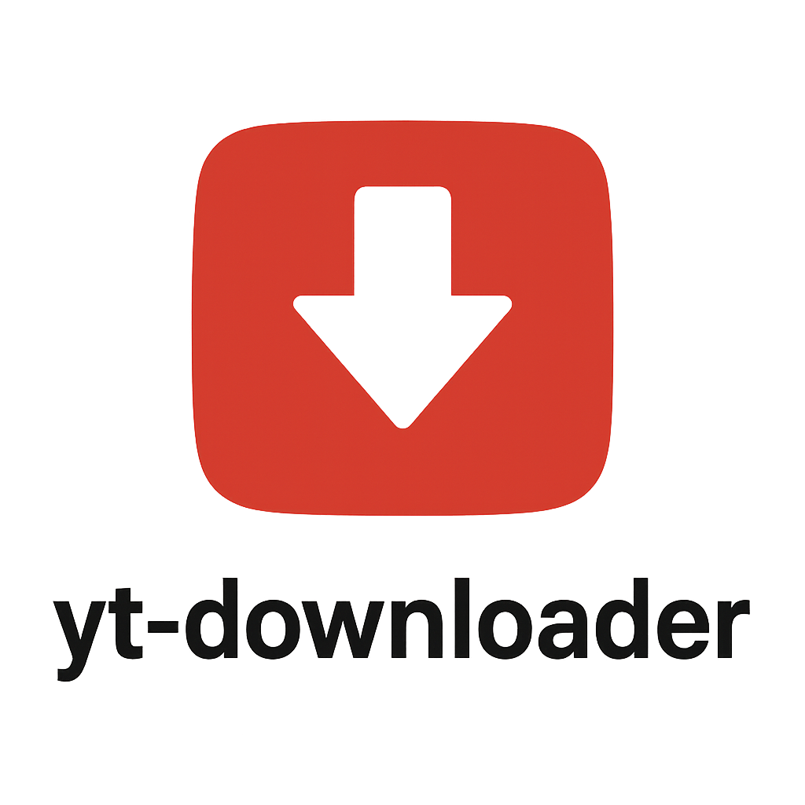
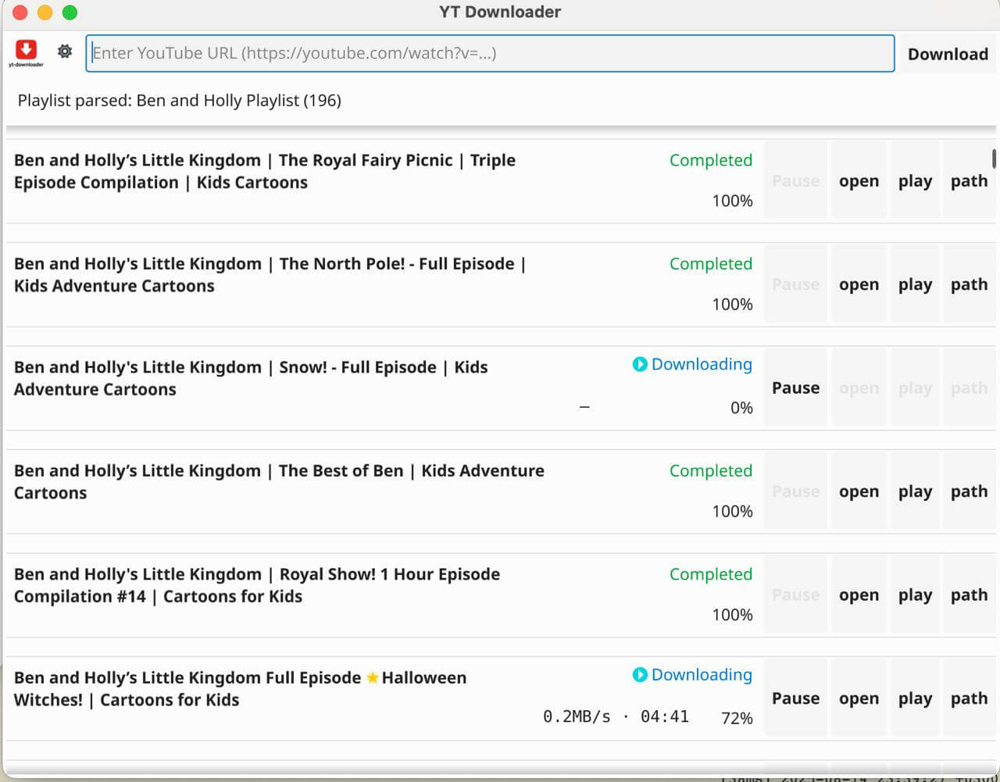
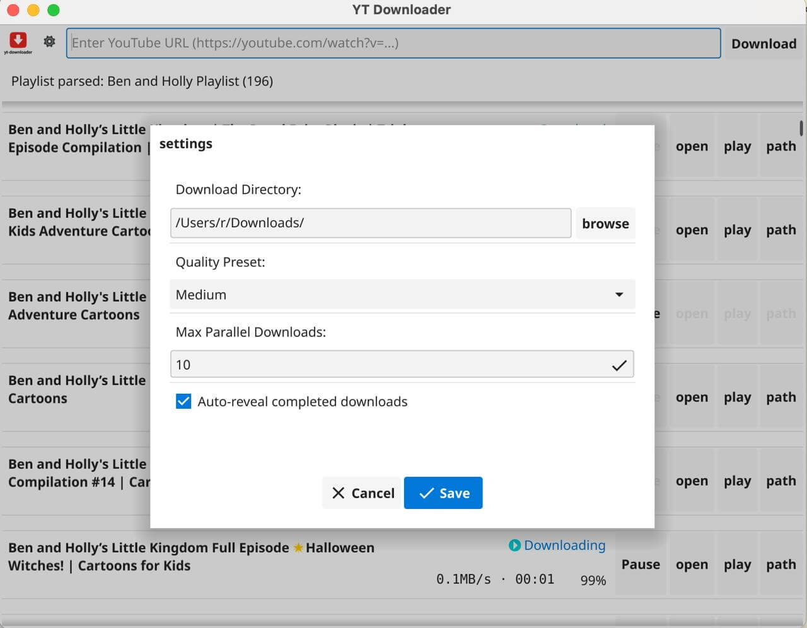

# yt-downloader

[](https://github.com/ytget/yt-downloader/actions/workflows/build.yaml)
[](https://goreportcard.com/report/github.com/ytget/yt-downloader)
[](https://github.com/ytget/yt-downloader)
[](https://github.com/ytget/yt-downloader/releases)
[](https://opensource.org/licenses/MIT)
[](https://github.com/ytget/yt-downloader)

Lightweight cross-platform desktop app to download YouTube videos and playlists. Built with **Wails** (Go backend + web frontend) and a pure Go download engine.

<div align="center">
    
</div>

### What is this?
yt-downloader is a desktop GUI application written in Go using [Wails](https://wails.io). It downloads single videos and entire playlists from YouTube, shows live progress, and stores files in your Downloads folder by default.

### Features
- Best-effort resilient downloads (continue, no-overwrite behavior).
- Playlist parsing via native Go engine for speed and stability.
- Live progress, speed, ETA; per-item Start/Pause, Open/Reveal, Remove.
- Parallel downloads with configurable limit.
- Quality presets (**best** / **medium**; audio-only not available yet — see [docs/QUALITY.md](docs/QUALITY.md)).
- Download modes: **Video**, **Video + Transcript**, **Transcript only** (YouTube captions → `.srt` + `.txt`).
- Auto language selection for captions; partial success if video works but captions are missing.
- Queue restore, batch actions, support bundle, optional update check.
- Localization: **Lietuvių** (default), English, Русский, Português, System.
- Cross-platform desktop (macOS, Linux, Windows) via Wails webview.

### Screenshots

<div align="center">
  <p><strong>Playlist downloading with live progress tracking</strong></p>
  

  <p><strong>Settings dialog with quality presets and localization</strong></p>
  
</div>

### Supported platforms
- macOS 12+
- Linux (X11/Wayland, WebKitGTK)
- Windows 10/11

### Architecture overview
- UI: Wails frontend (`frontend/`) talking to a Go `App` binding layer.
- Downloads: `github.com/ytget/ytdlp/v2` (pure Go engine) for single videos, playlists, and captions.
- Transcripts: caption fetch via ytdlp + `internal/transcript` writers (`.srt`, `.txt`).
- Settings: JSON file under the user config directory.
- Events: task progress and notifications are pushed to the UI over Wails events.

> Note: `go.mod` may temporarily `replace` `github.com/ytget/ytdlp/v2` with a fork tag until upstream captions APIs are merged — see [docs/RELEASING.md](docs/RELEASING.md).

### Documentation
- [User guide](docs/USER_GUIDE.md) — modes, files, troubleshooting
- [Architecture](docs/ARCHITECTURE.md) — packages and pipeline
- [Captions](docs/CAPTIONS.md) · [Quality](docs/QUALITY.md) · [Network](docs/NETWORK.md)
- [Packaging](docs/PACKAGING.md) · [Releasing](docs/RELEASING.md) · [Dependencies](docs/DEPENDENCIES.md)
- [CHANGELOG](CHANGELOG.md) · [Stability backlog](docs/STABILITY_TASKS.md)

### Requirements
- Go (matching `go.mod`, currently 1.26.x).
- Node.js 20+ (frontend build).
- [Wails CLI](https://wails.io/docs/gettingstarted/installation) v2.
- Platform webview deps (installed automatically on macOS/Windows; Linux needs WebKitGTK/GTK — see [docs/PACKAGING.md](docs/PACKAGING.md)).
- Optional but recommended: `ffmpeg` installed in `PATH` for muxing/format conversions.

### Installation

#### Download pre-built binaries
Go to the [Releases page](https://github.com/ytget/yt-downloader/releases) and download the latest version for your platform.

#### Install via Homebrew (macOS, GUI cask)
```bash
brew tap ytget/yt-downloader
brew install --cask yt-downloader
```

There is **no CLI formula** for the Wails desktop app. The in-repo `Formula/yt-downloader-cli.rb` is deprecated on purpose. Cask zap paths match Wails settings under `~/Library/Application Support/yt-downloader/`.

#### Build from source
```bash
git clone https://github.com/ytget/yt-downloader.git
cd yt-downloader
make deps
make build
# App binary / bundle is under build/bin/
```

### Quick start
```bash
make deps
make run   # wails dev
```

1. Paste a YouTube URL (single video or a playlist with `list=`).
2. Press **Download**.
3. Open **Settings** to change download folder, quality, parallelism, and language.

### Usage
- Single video: paste the video URL and click Download.
- Playlist: paste a URL containing `list=`; the app parses the list in the background and starts downloads.
- Each item exposes actions: Start/Pause, Reveal in Finder/Explorer, Open, Remove.

### Configuration (in-app Settings)
- Download directory: defaults to the system Downloads folder.
- Max parallel downloads: bounded to a safe range.
- Quality preset: best, medium, audio.
- Filename template: defaults to `%(title)s.%(ext)s`.
- Language: Lietuvių (default) / System / English / Русский / Português.
- Auto reveal on complete: open file location automatically after download.

Settings are stored as JSON in the OS user config directory (`yt-downloader/settings.json`).

### Development (Makefile driven)
```bash
make help
```

Key targets:
- `run` / `dev`: Wails development mode with live reload
- `build`: native production build for the current platform
- `build-mac` / `build-linux` / `build-windows`: platform builds
- `version` / `sync-version`: print / write `VERSION` into `wails.json`
- `sign-mac` / `sign-windows`: optional code signing helpers (see `docs/PACKAGING.md`)
- `test`: run Go tests
- `frontend-typecheck`: `tsc --noEmit`
- `lint`: `go vet`
- `deps`: download Go modules + install frontend packages
- `generate`: regenerate Wails TypeScript bindings
- `debug`: run dev mode and tee logs to `debug.log`
- `clean` / `clean-all`: remove build artifacts / node_modules

Packaging, signing secrets, and Linux WebKitGTK notes: [docs/PACKAGING.md](docs/PACKAGING.md).

### Project layout
```text
.
├── main.go                 # Wails entrypoint
├── app.go                  # Backend API bound to the frontend
├── frontend/               # Vite + TypeScript UI
├── internal/config         # JSON settings
├── internal/download       # download service
├── internal/model          # task/playlist models
├── internal/platform       # OS helpers (open/reveal/paths)
├── internal/compress       # optional compression helpers
├── wails.json
└── Makefile
```

### Troubleshooting
- Download issues: ensure network connectivity and valid URLs.
- Playlist returns 0 items: verify the URL contains `list=`.
- Linux build fails on webview: install `libgtk-3-dev` and `libwebkit2gtk-4.1-dev` (or 4.0).
- macOS Gatekeeper: you may need to allow the app/network access depending on your environment.

Capture logs:
```bash
make debug
```

### Legal note
This tool is intended for downloading content you have the rights to access. Respect platform Terms of Service and local laws.

### License
MIT (see `LICENSE` if present, otherwise repository license terms).

### Acknowledgements
- [Wails](https://wails.io) — Go + webview desktop framework
- [ytdlp](https://github.com/ytget/ytdlp) — pure Go download engine
